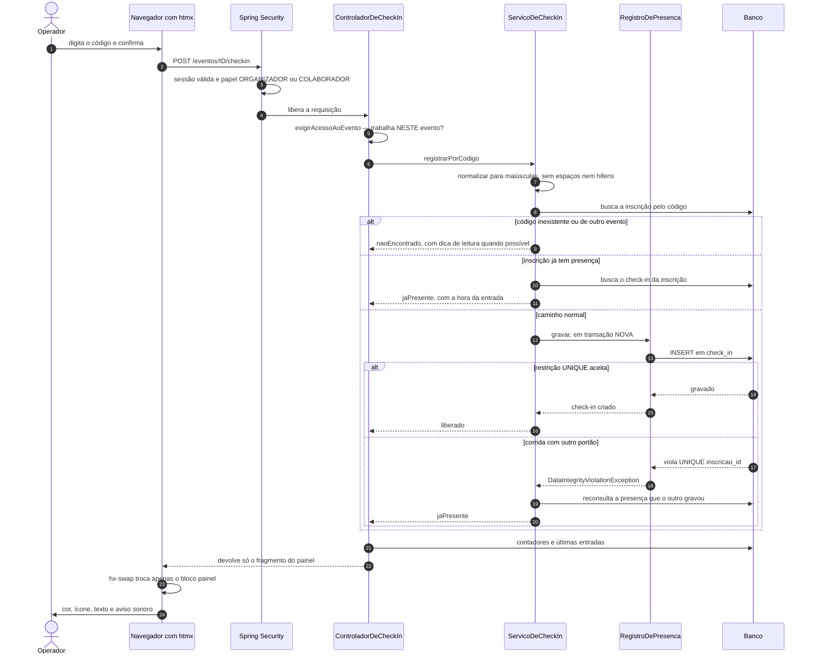
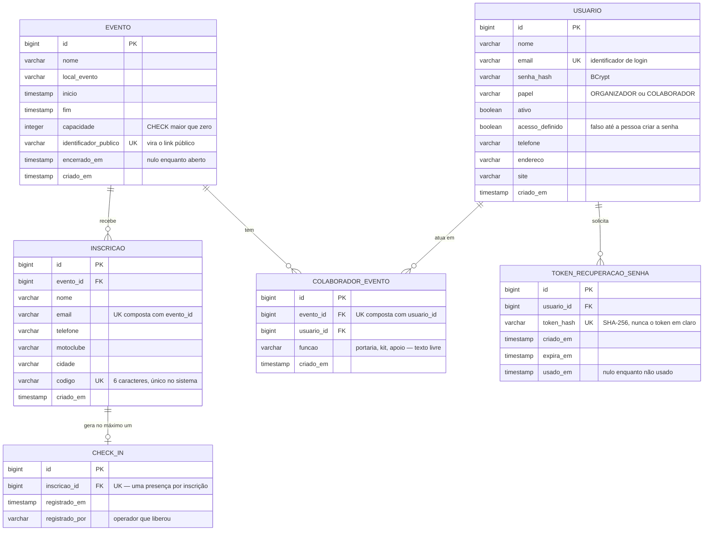
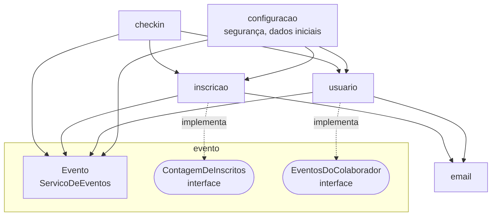
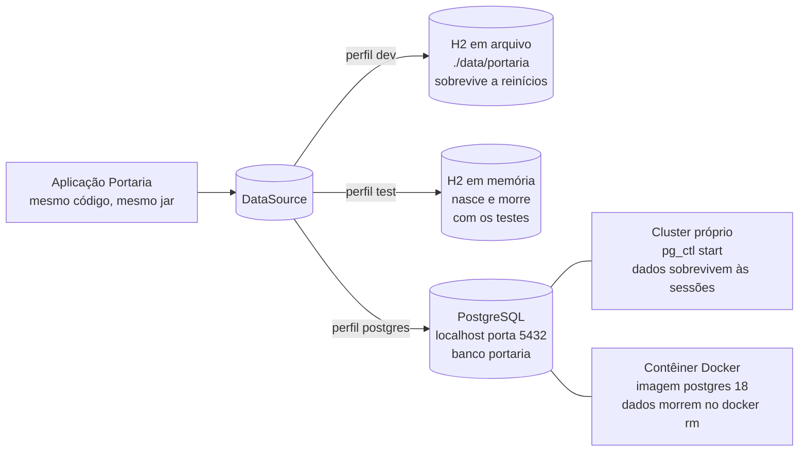
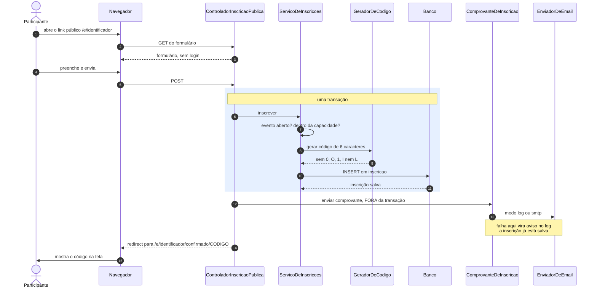

# Arquitetura do Portaria

Cinco desenhos, cada um respondendo a uma pergunta diferente sobre o sistema.
Os diagramas são escritos em Mermaid, que o GitHub renderiza sozinho: são texto
versionado, com diff legível, e não acrescentam ferramenta nenhuma ao projeto.

Uma observação que evita um mal-entendido comum: **não há um desenho por perfil.**
Os perfis `dev`, `test` e `postgres` compartilham o mesmo código, as mesmas
camadas e o mesmo fluxo — muda apenas quem responde na ponta do `DataSource`.
Isso está no diagrama 4, e é tudo o que há para dizer a respeito.

---

## 1. Check-in, do dedo do operador ao banco e de volta

É o caminho mais importante do sistema e o que concentra as decisões técnicas
da entrega.

**Quatro pontos deste diagrama costumam virar pergunta de banca.**

**A autorização acontece em duas alturas, e precisa das duas.** A cadeia de
filtros do Spring Security confere o *papel* — só ORGANIZADOR ou COLABORADOR
chegam ao controlador. Mas papel não diz em *qual* evento a pessoa trabalha, e
essa informação está no banco. Por isso o `exigirAcessoAoEvento` consulta o
vínculo antes de qualquer coisa. Sem ele, um colaborador trocaria o número na
URL e abriria o painel de outro evento — que é a falha mais comum em sistemas
com controle de acesso só por papel.

**A idempotência tem duas camadas, e a segunda é a que importa.** A consulta
prévia (`inscrição já tem presença?`) resolve o caso comum e dá uma resposta
boa ao operador. Ela sozinha, porém, seria um *check-then-act*: entre a
consulta e a gravação cabe outro operador, em outro portão, lendo o mesmo
código. Quem fecha essa janela é a restrição `UNIQUE (inscricao_id)` no banco —
e é por isso que o ramo "corrida com outro portão" existe no desenho.

**A transação nova não é preciosismo.** Quando a restrição dispara, o
PostgreSQL marca a transação corrente como *rollback-only*: qualquer comando
seguinte falha até alguém dar rollback. Se o `try/catch` estivesse dentro da
mesma transação, a reconsulta logo abaixo também morreria, e a fila pararia. O
`RegistroDePresenca` existe como componente separado só para carregar o
`REQUIRES_NEW` — assim a violação acontece numa transação descartável e o
serviço continua atendendo. **Este comportamento é do PostgreSQL; o H2 é mais
tolerante.** É a razão de o perfil `postgres` ser o de trabalho.

**O controlador devolve um fragmento, não uma página.** O htmx troca apenas o
bloco do painel, então o operador não perde o foco do campo nem a posição da
tela entre uma pessoa e outra. E o mesmo endereço responde a um POST comum: com
JavaScript desligado, o navegador simplesmente renderiza o fragmento. A portaria
não para de funcionar por causa do front-end.

---

## 2. Modelo de dados

Sete tabelas. As restrições estão desenhadas porque, neste projeto, elas
carregam regra de negócio — não são detalhe de implementação.

**Quatro restrições fazem trabalho de regra de negócio.**

`UNIQUE (inscricao_id)` em `check_in` é a idempotência do sistema inteiro,
escrita onde a concorrência de fato acontece.

`UNIQUE (codigo)` em `inscricao` é único no sistema, não por evento. É o que
permite ao operador digitar só o código, sem antes escolher o evento numa lista
— e o controlador confere depois se o código pertence *a este* evento.

`UNIQUE (evento_id, email)` impede a mesma pessoa de se inscrever duas vezes no
mesmo evento, e permite que se inscreva em outros.

`UNIQUE (evento_id, usuario_id)` em `colaborador_evento` diz que o vínculo é por
evento: quem trabalhou na edição de março não continua com acesso à de setembro.

E duas colunas guardam decisões de segurança. `token_hash` guarda o SHA-256 do
token, nunca o token em claro — se o banco vazar, os links de recuperação não
servem para nada, pelo mesmo motivo que senha não se guarda em texto puro.
`usado_em` torna o token de uso único sem apagar a linha, o que deixa rastro de
quando o acesso foi recuperado.

---

## 3. Camadas e dependências entre pacotes

Monolito modular: um pacote por domínio, e as setas importam tanto quanto as
caixas.

**O pacote `evento` não aponta para ninguém, e isso foi construído.** Ele
precisa saber quantas pessoas se inscreveram e em que eventos um colaborador
trabalha — duas informações que vivem em `inscricao` e `usuario`. O caminho
ingênuo seria `evento` importar os dois, e aí surgiria o ciclo
`inscricao → evento → inscricao`.

A saída é inversão de dependência: **a interface é declarada no pacote que
precisa da informação**, não no que a produz. `ContagemDeInscritos` e
`EventosDoColaborador` moram em `evento`; quem as implementa são
`ContagemDeInscritosPorRepositorio`, em `inscricao`, e
`EventosDoColaboradorPorRepositorio`, em `usuario`. As setas de implementação
apontam para dentro de `evento`, e o ciclo não existe.

**O pacote `email` é folha de propósito.** Ele nasceu dentro de `usuario`, onde
foi usado primeiro — recuperação de senha e convite. Quando a inscrição passou a
mandar o código por e-mail, `inscricao` precisaria importar `usuario`, e aí
apareceria o ciclo `inscricao → usuario → evento → inscricao`. Mover o envio
para um pacote sem dependência nenhuma resolveu sem contorno: quem precisa
enviar, importa `email`, e `email` não importa ninguém.

**`configuracao` aponta para todo mundo e ninguém aponta para ele.** É onde
moram a cadeia de filtros do Spring Security e o semeador de dados iniciais —
código de montagem, que por natureza conhece as peças sem ser conhecido por
elas.

---

## 4. Perfis e fornecedores de banco

Este é o desenho que substitui "um diagrama por perfil". A aplicação é a mesma
nos três; o que muda é quem atende na outra ponta.

**O perfil diz o que a aplicação procura; quem fornece aquilo é outra coisa.**
O `application-postgres.properties` pede um PostgreSQL naquele endereço, com
banco, usuário e senha `portaria`. Ele não tem como saber se quem respondeu foi
o cluster instalado na máquina ou um contêiner.

Isso foi verificado em 29/10/2026: o mesmo perfil, o mesmo comando e a mesma
configuração subiram contra um `postgres:18` em contêiner criado minutos antes,
vazio. O Flyway construiu as sete migrações do zero, o `ddl-auto=validate`
passou e o check-in funcionou — inclusive o caminho da leitura repetida. Nenhuma
linha de SQL ou de Java foi escrita para aquele banco.

Cluster e contêiner disputam a porta 5432, então vale um por vez. A escolha é
sobre os dados: o cluster os mantém entre sessões, o contêiner os descarta no
`docker rm`. Para desenvolver ao longo de dias, cluster. Para provar que o
esquema nasce correto do nada, contêiner.

---

## 5. Inscrição pública, do link ao código

O outro ciclo de vida do sistema: como uma pessoa entra na lista antes do dia do
evento.

**O e-mail sai de dentro da transação de propósito.** Entrega de e-mail depende
de rede e de um servidor que não é nosso; é a parte mais frágil do caminho. Se
ela estivesse na mesma transação, uma caixa de entrada indisponível desfaria uma
inscrição que já era válida — e a pessoa, de pé no formulário, veria um erro sem
causa aparente. Fora da transação, a falha vira um aviso no log e o participante
continua com o código na tela, que é o que de fato o faz entrar no evento.

**A tela é a entrega principal; o e-mail é a cópia.** Por isso o `redirect` leva
a uma página que mostra o código, e não a uma mensagem do tipo "confira seu
e-mail".

**O gerador exclui `0`, `O`, `1`, `I` e `L`.** Sob chuva, no escuro e com fila
andando, um caractere ambíguo custa mais tempo que um código um pouco maior. E
essa decisão volta no check-in: quando o operador digita um código contendo um
desses caracteres, o sistema sabe que houve erro de leitura e diz onde procurar,
em vez de um "não encontrado" seco.
