# Manual do Usuário

**Portaria** · Sistema de inscrições e controle de entrada em eventos presenciais

Instituto Federal de Educação, Ciência e Tecnologia de Santa Catarina - IFSC
Câmpus Gaspar

**Aluno:** Jarbas de Morais Ferreira Junior
**Disciplina:** Projeto Integrador I
**Professores:** [Renato Simões Moreira](https://sigaa.ifsc.edu.br/sigaa/public/RedirectDocente/renato.simoes)
e [Simone de Ramos](https://sigaa.ifsc.edu.br/sigaa/public/RedirectDocente/simone.ramos)

Versão 1.0 · Gaspar, Santa Catarina · Novembro de 2026

> Este documento também está disponível
> [em PDF](manual-do-usuario.pdf), com capa e sumário paginado.

---

## Sumário

1. [Apresentação](#1-apresentação)
2. [Como o sistema funciona](#2-como-o-sistema-funciona)
3. [Acesso ao sistema](#3-acesso-ao-sistema)
4. [Eventos](#4-eventos)
5. [Inscrição do participante](#5-inscrição-do-participante)
6. [Painel de portaria](#6-painel-de-portaria)
7. [Equipe do evento](#7-equipe-do-evento)
8. [Minha conta](#8-minha-conta)
9. [No dia do evento](#9-no-dia-do-evento)
10. [Perguntas frequentes](#10-perguntas-frequentes)
11. [Suporte](#suporte)

---

## 1. Apresentação

O **Portaria** organiza as inscrições de um evento presencial e controla quem
entra no dia. Ele responde a uma pergunta simples e difícil de responder no
portão: **esta pessoa está inscrita, e já entrou?**

O sistema foi pensado para encontros de motoclube, mas atende qualquer evento
com entrada controlada: feira, festa de clube, encontro cultural, atividade
acadêmica.

Três pessoas diferentes usam o sistema, cada uma de um jeito:

| | Quem | O que faz | Precisa de conta? |
|---|---|---|---|
|  | **Organizador** | Cria o evento, divulga o link, acompanha as inscrições, monta a equipe | Sim |
|  | **Colaborador** | Opera o painel de portaria no dia do evento | Sim, por convite |
|  | **Participante** | Se inscreve pelo link público e recebe um código | Não |

O participante nunca cria conta nem senha. Ele preenche um formulário e recebe
um código de seis caracteres, e é esse código que vale na entrada.

---

## 2. Como o sistema funciona

O ciclo completo tem quatro passos:

1. O organizador **cria o evento** e recebe um link público de inscrição.
2. O participante **se inscreve** por esse link, sem login, e recebe um
   **código de seis caracteres**.
3. Na entrada, o operador **digita o código** no painel de portaria.
4. O sistema responde de uma entre três formas, **entrada liberada**,
   **já registrado** ou **código não encontrado**, e o contador de presentes
   atualiza na hora.

Os códigos nunca usam os caracteres **0, O, 1, I e L**. Essa escolha é
proposital: sob chuva, no escuro e com fila andando, um caractere ambíguo custa
mais tempo que um código um pouco maior.

---

## 3. Acesso ao sistema

### 3.1 Entrar

Abra o endereço do sistema no navegador. A tela de entrada pede o **e-mail** e a
**senha** da sua conta.

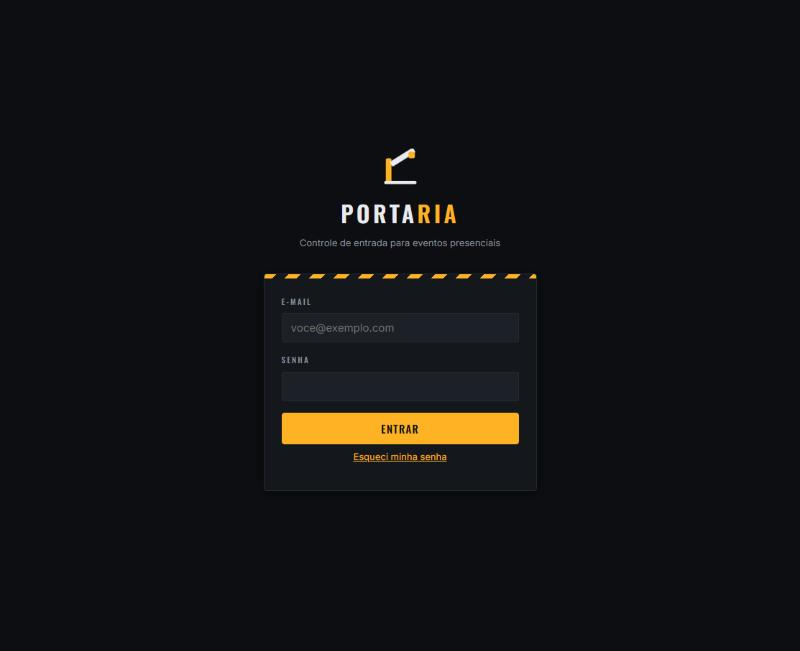

*Figura 1. Tela de entrada.*

> **Dica.** No celular que vai operar a portaria, abra o sistema no navegador e
> use "Adicionar à tela de início". O endereço vira um ícone, e no dia do evento
> ninguém perde tempo digitando URL no escuro.

O login é feito pelo **e-mail**, não por um apelido ou nome de usuário. Se o
e-mail ou a senha estiverem errados, o sistema responde apenas
"usuário ou senha inválidos", sem dizer qual dos dois falhou. Isso é intencional,
e evita que alguém descubra quais endereços têm conta no sistema.

### 3.2 Esqueci minha senha

No rodapé da tela de entrada existe o link **Esqueci minha senha**. Informe o
e-mail da sua conta e o sistema envia um link para você escolher uma senha nova.

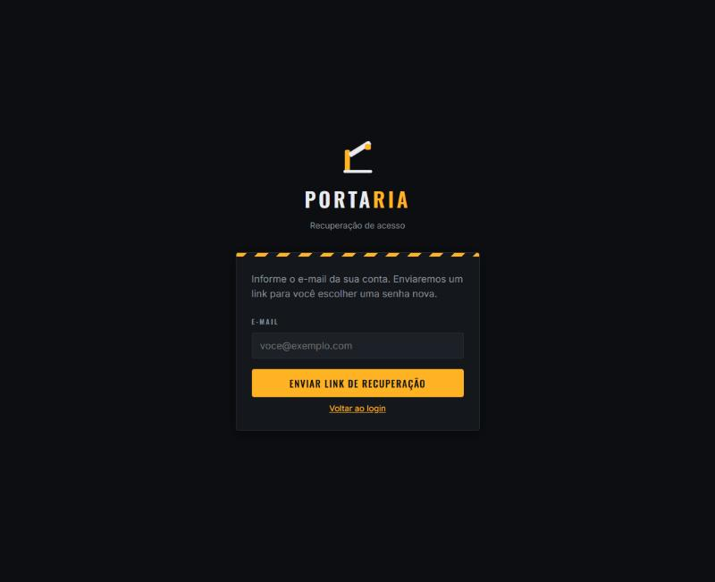

*Figura 2. Recuperação de acesso.*

O link de recuperação tem prazo de validade e só pode ser usado uma vez. Se
ninguém receber o e-mail, confira a caixa de spam antes de pedir outro.

---

## 4. Eventos

### 4.1 Tela de eventos

Depois de entrar, você vê a lista dos seus eventos à esquerda e o formulário de
cadastro à direita.

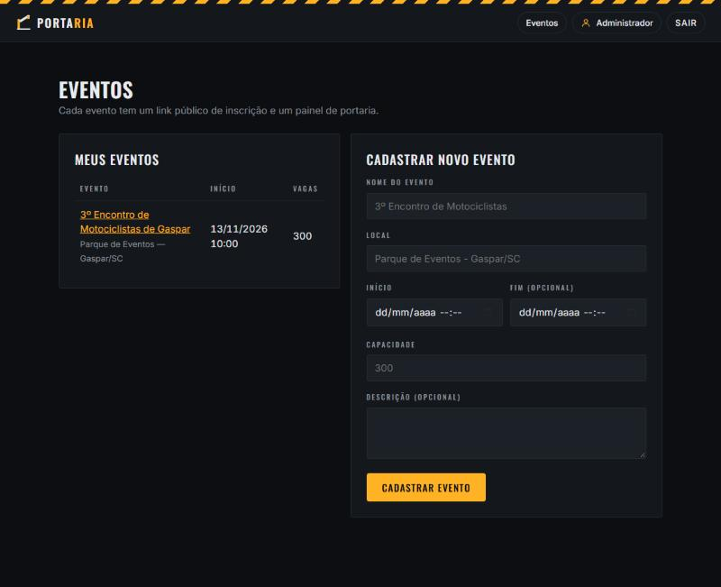

*Figura 3. Tela de eventos.*

Quem entra como **colaborador** vê nesta mesma tela apenas os eventos em que
trabalha, sem o formulário de cadastro.

### 4.2 Cadastrar um evento

Preencha os campos do formulário **Cadastrar novo evento**:

| Campo | Obrigatório | Observação |
|---|---|---|
| Nome do evento | Sim | Aparece no link público e no painel de portaria |
| Local | Sim | Endereço ou nome do espaço |
| Início | Sim | Data e hora |
| Fim | Não | Para eventos de mais de um dia |
| Capacidade | Sim | Número de vagas, usado para calcular a lotação |
| Descrição | Não | Texto que o participante lê antes de se inscrever |

Ao confirmar, o evento aparece na lista e já nasce com link público e painel de
portaria prontos.

### 4.3 A página do evento

Clique no nome do evento na lista para abrir a página dele.

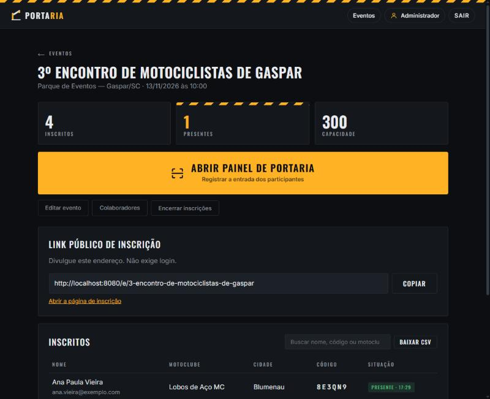

*Figura 4. Página do evento.*

No topo ficam três indicadores, **inscritos**, **presentes** e **capacidade**.
Logo abaixo, o botão **Abrir painel de portaria**, que é por onde se registra a
entrada no dia.

A faixa **Link público de inscrição** mostra o endereço que você divulga. O botão
**Copiar** coloca o endereço na área de transferência, pronto para colar em um
grupo de mensagens ou em uma publicação. Esse link **não exige login**: qualquer
pessoa com o endereço consegue se inscrever.

> **Dica.** Antes de divulgar, abra o link em uma aba anônima do navegador.
> É assim que você vê exatamente o que o participante vê, sem a sua sessão de
> organizador interferir.

Os três botões menores são:

- **Editar evento**, para corrigir nome, local, data ou capacidade.
- **Colaboradores**, para montar a equipe que vai operar a portaria.
- **Encerrar inscrições**, para fechar o formulário público.

Encerrar não é definitivo. O botão passa a oferecer **Reabrir inscrições**, e é
comum fechar na véspera, para fechar a contagem de kits, e reabrir no dia quando
aparece gente no portão.

### 4.4 Lista de inscritos

Mais abaixo na mesma página fica a lista de quem se inscreveu.

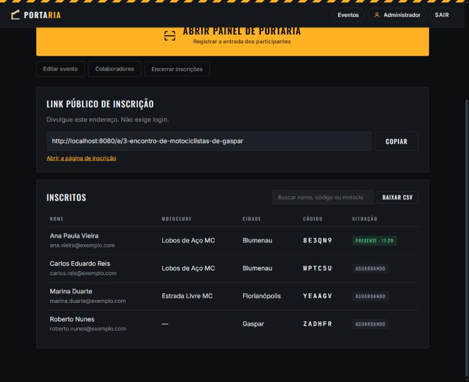

*Figura 5. Lista de inscritos.*

Cada linha mostra nome, e-mail, motoclube, cidade, o **código de entrada** e a
**situação**, que pode ser:

- **Aguardando**, quem ainda não chegou.
- **Presente**, com o horário em que a entrada foi registrada.

O campo de busca filtra por nome, código ou motoclube enquanto você digita, e
ignora acentos: digitar "jose" encontra "José". Serve para achar alguém que
perdeu o código.

O botão **Baixar CSV** gera uma planilha com todos os inscritos, pronta para
abrir no Excel. Use para conferência, lista de kits ou prestação de contas.

> **Dica.** Baixe o CSV na véspera e leve no celular ou impresso. Se a rede falhar
> no dia, você ainda tem a lista com nomes e códigos para conferir na mão.

---

## 5. Inscrição do participante

Esta é a parte que o público vê. Ela não exige conta nem senha.

### 5.1 O formulário

Ao abrir o link divulgado, o participante encontra os dados do evento, quantas
vagas ainda restam e o formulário de inscrição.

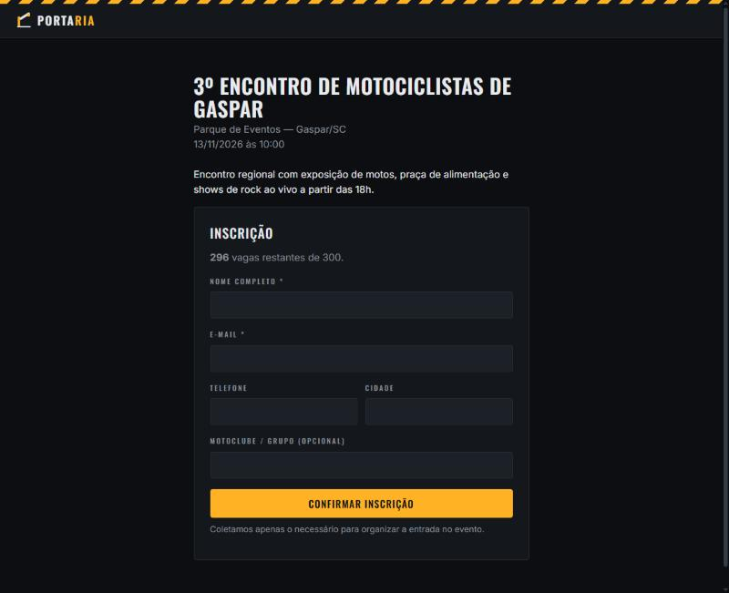

*Figura 6. Página pública de inscrição.*

Apenas **nome** e **e-mail** são obrigatórios. Telefone, cidade e motoclube são
opcionais, e existem para ajudar a organização a conhecer o público.

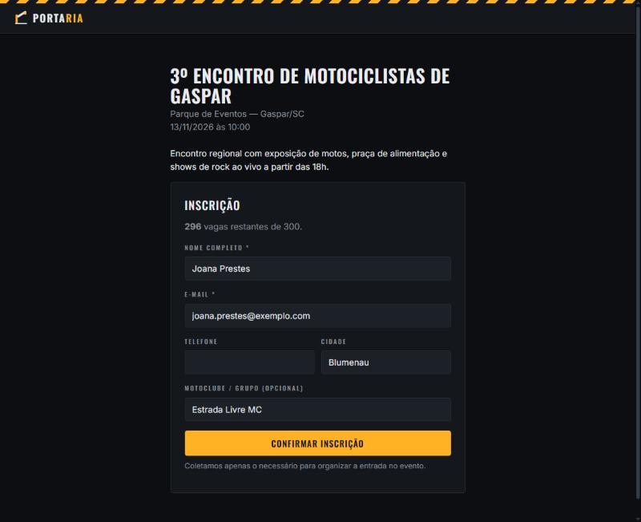

*Figura 7. Formulário preenchido.*

### 5.2 O código de entrada

Ao confirmar, o participante recebe o código na tela.

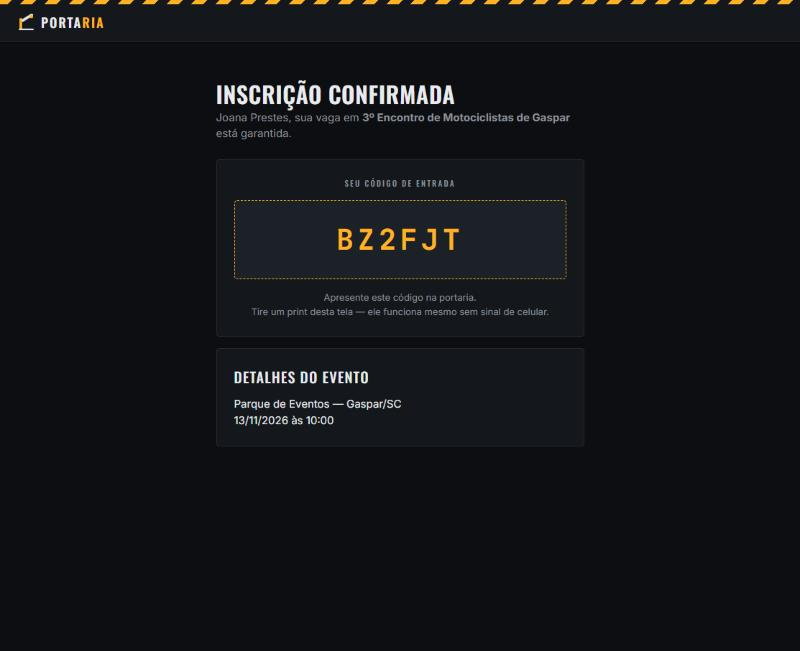

*Figura 8. Inscrição confirmada, com o código de entrada.*

**O código na tela é a entrega principal.** O mesmo código também é enviado para
o e-mail informado, mas a tela não depende disso: oriente o participante a tirar
uma foto da tela, porque assim o código funciona mesmo sem sinal de celular no
local do evento.

> **Dica.** Peça ao participante para tirar uma foto da tela assim que o código
> aparecer. Foto funciona sem sinal de celular, sem bateria para abrir e-mail e
> sem depender de a mensagem ter chegado.

A mesma pessoa não consegue se inscrever duas vezes no mesmo evento com o mesmo
e-mail. Se tentar, o sistema avisa.

---

## 6. Painel de portaria

É a tela usada no portão, com a fila andando. Ela foi desenhada para ser operada
no celular, com uma mão, à noite.

### 6.1 Abrindo o painel

Na página do evento, toque em **Abrir painel de portaria**.

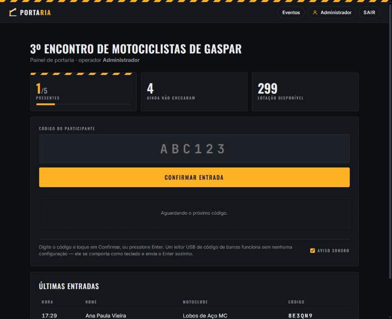

*Figura 9. Painel de portaria.*

No topo ficam três números que mudam a cada entrada:

- **Presentes**, quantos já entraram, sobre o total de inscritos.
- **Ainda não chegaram**, quantos faltam.
- **Lotação disponível**, quantas vagas restam diante da capacidade.

> **Dica.** Antes de abrir o portão, aumente o tempo de bloqueio de tela do
> celular, ou desligue o bloqueio automático. Tela apagando a cada trinta
> segundos com fila andando custa mais tempo do que parece.

### 6.2 Registrando uma entrada

Digite o código do participante e toque em **Confirmar entrada**, ou pressione
Enter. O sistema responde de uma entre três formas.

**Entrada liberada.** A pessoa está inscrita e é a primeira vez que o código é
lido. O nome aparece em destaque, o contador sobe e a entrada passa a constar em
"Últimas entradas".

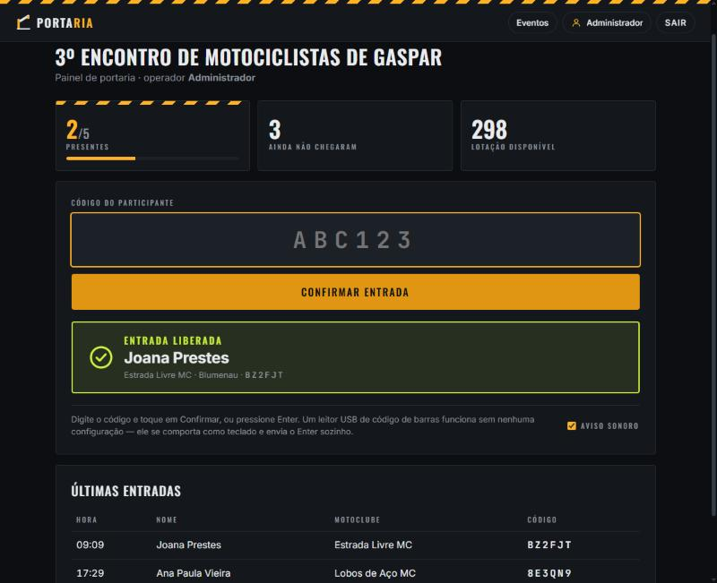

*Figura 10. Entrada liberada.*

**Já registrado.** O código é válido, mas aquela inscrição já entrou. O sistema
mostra o horário da primeira entrada e o contador **não** sobe.

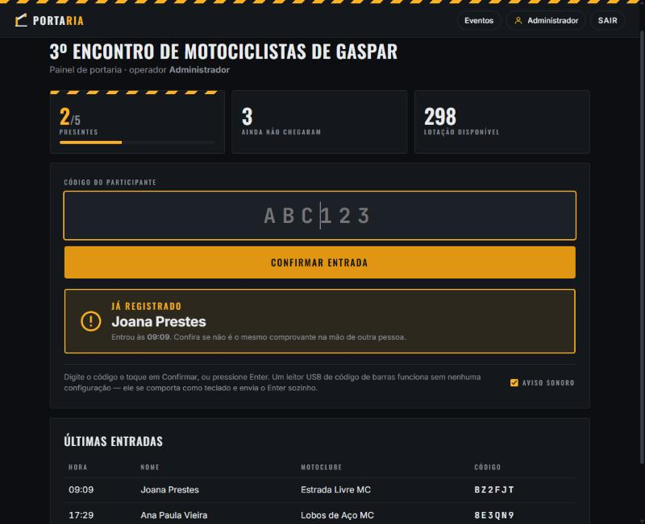

*Figura 11. Código já registrado.*

Esse aviso merece atenção. Ele costuma significar uma de duas coisas: a pessoa
já entrou e voltou, o que é normal, ou **o mesmo comprovante está na mão de
outra pessoa**, o que não é. Confira o documento antes de liberar.

**Código não encontrado.** O código não corresponde a nenhuma inscrição deste
evento.

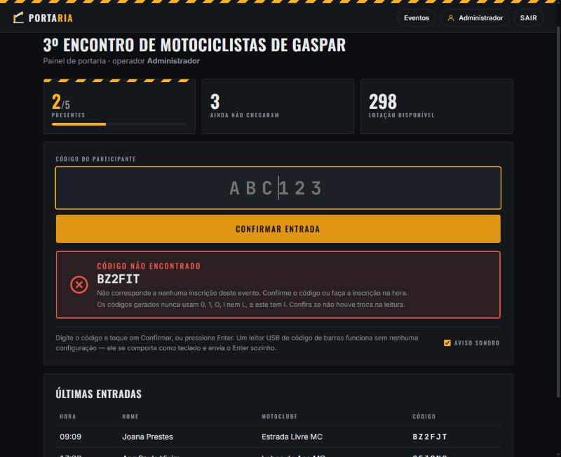

*Figura 12. Código não encontrado.*

Quando o sistema consegue identificar o provável erro de leitura, ele avisa. No
exemplo acima o código digitado tem a letra **I**, que nunca é usada nos códigos
gerados, então o aviso aponta onde procurar a confusão. Nesses casos, peça para
a pessoa mostrar a tela novamente, ou busque pelo nome na lista de inscritos.

Se mesmo assim não houver inscrição, a pessoa pode se inscrever na hora pelo
link público, desde que as inscrições estejam abertas.

### 6.3 Aviso sonoro

No canto inferior direito do painel existe a opção **Aviso sonoro**, ligada por
padrão. Com ela ativa, cada resultado toca um som diferente:

- **Entrada liberada**, um toque claro, como um sino.
- **Já registrado**, dois toques iguais e secos.
- **Código não encontrado**, um som grave e áspero.

Isso existe porque no portão o operador olha para a pessoa, não para a tela. O
som avisa antes de o olho voltar para o celular.

Vale saber três coisas sobre esse recurso:

- **Os sons são gerados pelo próprio navegador**, não são arquivos de áudio. Por
  isso funcionam sem internet e não há nada para baixar.
- **O navegador pode bloquear o som** até que alguém toque na página. É uma
  proteção padrão contra sites que tocam áudio sozinhos. Se o primeiro código
  lido não emitir som, toque uma vez na tela e leia o próximo: a partir daí o
  aviso funciona normalmente.
- **A escolha fica guardada no próprio aparelho.** Cada operador liga ou desliga
  o som no celular dele, sem afetar os outros.

O som é sempre reforço, nunca a única informação. Qualquer resultado aparece na
tela com cor, ícone e texto, mesmo com o aviso sonoro desligado.

### 6.4 Como o código chega ao painel

Nesta versão, o código entra no painel de **uma** forma: digitado no campo. É
para isso que o sistema foi desenhado, e é por isso que os códigos têm só seis
caracteres e evitam letras que se confundem.

**Leitura por câmera do celular não está disponível nesta versão.** A leitura de
QR Code está prevista para a próxima etapa do projeto, e depende de o sistema ser
publicado em HTTPS, porque a câmera do navegador só funciona em conexão segura.

**Sobre leitores USB de código de barras.** Esses aparelhos se comportam como
teclado: digitam o conteúdo lido e enviam o Enter sozinhos. Como o painel aceita
exatamente isso, a expectativa é que funcionem sem nenhuma configuração, bastando
manter o cursor no campo. **Essa possibilidade não foi testada com um leitor
físico**, então trate-a como provável, não como garantida, e teste antes do
evento se pretende usar um.

---

## 7. Equipe do evento

Quem opera a portaria não precisa ser o organizador. Cada colaborador tem conta
própria, e é assim que o sistema registra quem liberou cada entrada.

### 7.1 Incluir colaborador

Na página do evento, toque em **Colaboradores**.

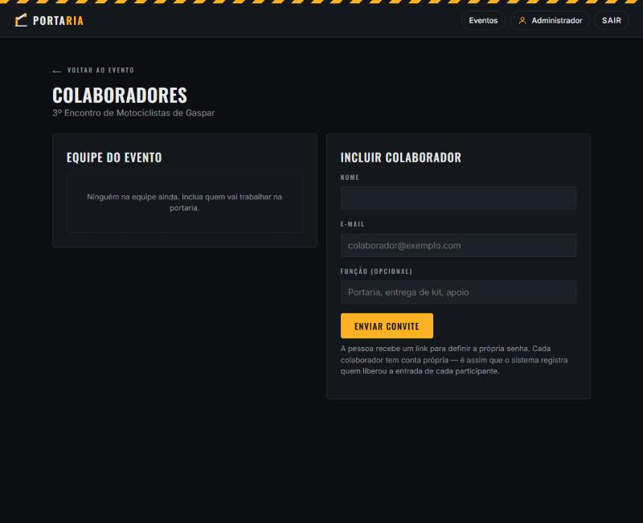

*Figura 13. Tela de colaboradores.*

Informe nome, e-mail e, se quiser, a função dentro do evento (portaria, entrega
de kit, apoio). Toque em **Enviar convite**.

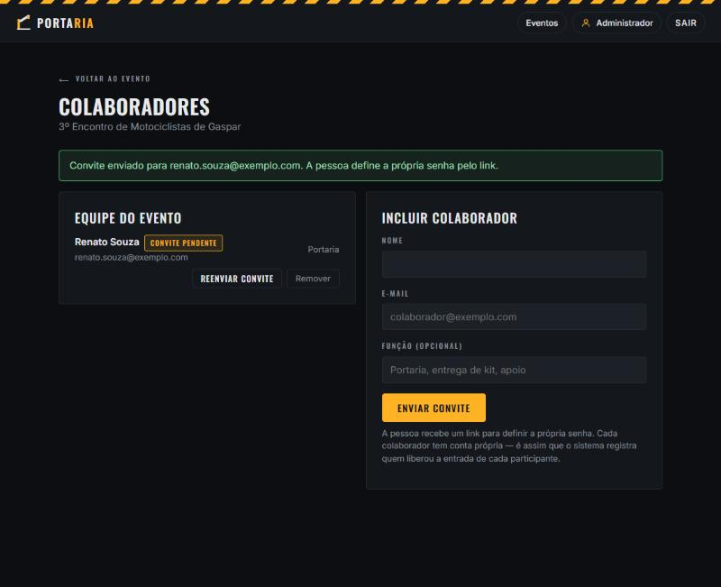

*Figura 14. Colaborador incluído.*

A pessoa recebe um link por e-mail para definir a própria senha. Até isso
acontecer, ela aparece na equipe com a marca **convite pendente**.

> **Dica.** Convide a equipe com alguns dias de antecedência e confirme que todos
> conseguiram definir a senha. Descobrir no portão que o colaborador nunca abriu
> o convite é o tipo de problema que não se resolve com fila esperando.

### 7.2 Reenviar e remover

- **Reenviar convite**, quando o e-mail não chegou ou o prazo venceu.
- **Remover**, para tirar a pessoa da equipe.

O vínculo é **por evento**. Quem trabalhou na edição de março não continua com
acesso à de setembro, e isso é proposital: o acesso acompanha o trabalho.

---

## 8. Minha conta

No menu superior, **Administrador** leva à sua conta.

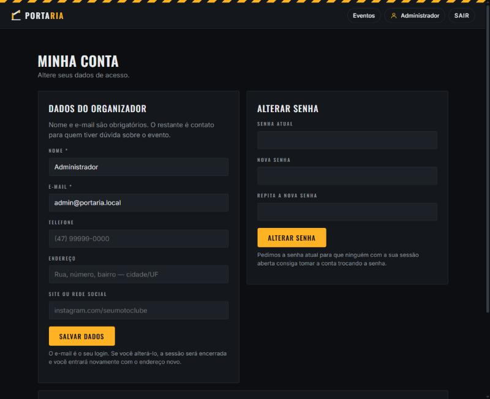

*Figura 15. Minha conta.*

À esquerda ficam os seus dados. Nome e e-mail são obrigatórios; telefone,
endereço e site são contato para quem tiver dúvida sobre o evento.

**Atenção ao alterar o e-mail:** ele é o seu login. Se mudar, a sessão é
encerrada e você entra novamente com o endereço novo.

À direita fica a troca de senha. O sistema pede a senha atual de propósito,
para que ninguém que encontre a sua sessão aberta consiga tomar a conta trocando
a senha.

---

## 9. No dia do evento

Uma lista curta, feita para ser conferida antes de abrir o portão.

**Antes de começar**

- Confira se o painel de portaria abre no celular que será usado.
- Entre com a conta do colaborador que vai operar, não com a do organizador.
- Deixe o aviso sonoro ligado e teste o volume do aparelho.
- Se for usar leitor de código de barras, teste com um código real.
- Baixe o CSV dos inscritos como cópia de segurança em papel ou no celular.

**Durante o evento**

- Mantenha o painel aberto na mesma aba. Ele se atualiza sozinho a cada leitura.
- Leia "já registrado" como um pedido de conferência, não como um erro do sistema.
- Se as inscrições estiverem abertas, quem chegar sem código pode se inscrever
  na hora pelo link público.

**Se a tela não responder**

O painel avisa quando a entrada **não** foi registrada: aparece um aviso de
"sem resposta do servidor". Se isso acontecer, confira a conexão e leia o código
de novo. Enquanto não aparecer o resultado na tela, considere que a entrada não
foi registrada.

---

## 10. Perguntas frequentes

**O participante precisa criar conta?**
Não. Ele preenche o formulário público e recebe o código. Conta só é necessária
para organizador e colaborador.

**E se a pessoa perder o código?**
Busque pelo nome na lista de inscritos, na página do evento. O código aparece
na própria lista.

**O mesmo código pode ser usado por duas pessoas?**
Não. Na segunda leitura o sistema responde "já registrado" e mostra o horário da
primeira entrada. O contador de presentes não sobe.

**Dá para usar em mais de um portão ao mesmo tempo?**
Sim. Vários operadores podem usar o painel ao mesmo tempo, e o sistema impede
que a mesma inscrição conte duas vezes, mesmo que dois portões leiam o mesmo
código no mesmo instante.

**Funciona sem internet?**
O sistema não depende da internet, mas depende da rede em que o servidor está.
O celular do operador precisa alcançar o servidor. As telas não buscam nada de
fora: fontes, estilos e sons estão no próprio sistema.

**Posso reabrir inscrições depois de encerrar?**
Sim. Encerrar e reabrir são ações simétricas, e o evento encerrado continua
editável.

**O que acontece se o número de presentes passar da capacidade?**
O sistema não impede a entrada, porque essa decisão é da organização. Mas o
indicador muda para **Acima da capacidade** e destaca o excesso, para que quem
está no portão perceba.

---

## Suporte

Dúvidas sobre o uso do sistema, problemas encontrados ou sugestões podem ser
enviadas diretamente ao desenvolvedor:

**Jarbas de M. Ferreira Jr.** / E-mail: <jarbas.m01@aluno.ifsc.edu.br>
